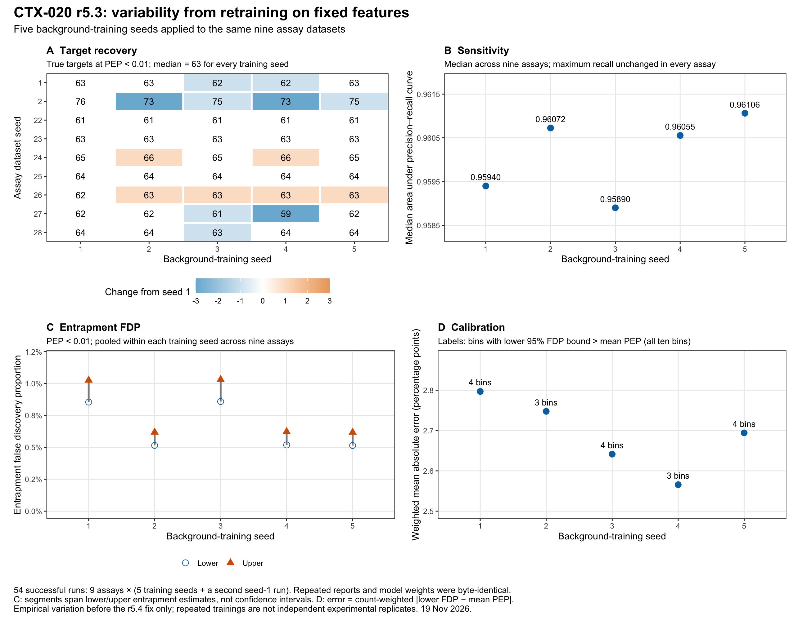

# CTX020-045 — r5.3 fixed-feature training variability, 2026-11-19

All 54 confidence reruns completed successfully: nine assay datasets × background-training seeds 1–5, plus a second seed-1 run for every assay. This completes the requested noise-floor experiment, not the r5.4 scientific comparison or CTX020-045 as a whole.

## Method and reproducibility

The original r5.3 split feature files and pairing sidecars were mounted read-only. Models were trained on background peptides and applied to reference peptides; no raw search or feature extraction was rerun. The frozen current jar has unchanged confidence-stage source and dependencies relative to r5.3 commit `1cf1985`; the r5.4 extraction/cache changes are not exercised by this input route. Runtime: Linux x86-64, Java 17.0.21, Percolator 3.01, pyIsoPEP 0.1.4, q2pep --calc-q-from-fdr; exact identities and dependency versions are in the experiment provenance.

All nine same-seed comparisons passed: 18 peptide/PSM reports, 18 native/averaged model-weight files and nine reference score tables are byte-identical. Maximum same-seed score/q-value/PEP difference is zero. Compared with uploaded seed-1 results, the maximum numeric difference is 2.22e-16; the pilot reference score table is byte-identical. All runs used the requested recorded Percolator seed, all peptide sequence/charge matches succeeded, scores/q-values/PEPs are finite and valid, and all 36 source feature/sidecar hashes are unchanged.

The registered `docs/validation/ctx020_confidence_assessment.R` was reused unchanged for every complete training-seed matrix. Peptides match their assay by modified sequence and charge, with the established N-terminal acetylation normalization. Scheduled RT is annotation, not a filtering condition. Each assay has 96 true targets and 480 entrapments. Calibration uses the original ten squared-edge bins and exact binomial intervals; upper entrapment FDP is lower FDP × 1.2, capped at one. Precision–recall uses native peptide score with ties entering together. PEP < 0.01 is strict; q ≤ 0.01 includes equality.

## Results

Training seeds identify repeated model training; assay seeds identify different datasets. The duplicate seed-1 run is excluded from spread summaries.

| Training seed | Pooled true targets, PEP < 0.01 | Pooled entrapments, PEP < 0.01 | Upper FDP | Median targets per assay | Median AUPRC | Calibration absolute error | Flagged bins |
|---|---:|---:|---:|---:|---:|---:|---:|
| 1 | 580 | 5 | 1.026% | 63 | 0.959399 | 2.797 percentage points | 4 |
| 2 | 579 | 3 | 0.619% | 63 | 0.960724 | 2.748 percentage points | 3 |
| 3 | 577 | 5 | 1.031% | 63 | 0.958901 | 2.641 percentage points | 4 |
| 4 | 575 | 3 | 0.623% | 63 | 0.960554 | 2.566 percentage points | 3 |
| 5 | 580 | 3 | 0.617% | 63 | 0.961061 | 2.694 percentage points | 4 |

Calibration absolute error is the count-weighted mean of |lower entrapment FDP − mean PEP| across pooled bins. Pooled here means pooling the nine assays within one training seed, not pooling repeated trainings as independent experiments.

Across the five training seeds:

- The median target count at PEP < 0.01 is always 63; the median paired target-count change from training seed 1 is always zero. Individual assays vary by 0–3 targets; assay seeds 2 and 27 have the largest ranges (73–76 and 59–62).
- Pooled target recovery ranges from 575 to 580 and pooled entrapments from 3 to 5. Upper entrapment FDP at PEP < 0.01 ranges from 0.6175% to 1.0309%, a full range of 0.4134 percentage points.
- Median AUPRC ranges from 0.958901 to 0.961061 (full range 0.002160). Median paired AUPRC change from seed 1 ranges from −0.000498 to +0.000085. Maximum recall is unchanged in every assay.
- Calibration absolute error ranges from 0.025658 to 0.027970 (full range 0.002312, or 0.2312 percentage points).
- At q ≤ 0.01, pooled lower/upper FDP ranges are 2.4142–2.6854% / 2.8971–3.2225%; excluding assay seed 2, they are 1.4663–1.6105% / 1.7595–1.9327%.

The full range, maximum absolute departure from seed 1, sample SD, per-assay results and paired sensitivity deltas are preserved in the TSVs. These describe five retrainings on fixed data. They are not confidence intervals for the variability, proof of equivalence, or evidence about variability after the r5.4 fix.

## Approved counting rule

The earlier criterion recorded r5.3 as having three bins with a 95% interval entirely above the diagonal. Applying its stated all-ten-bin rule to both the archived and recomputed seed-1 tables gives four: [0,0.01), [0.49,0.64), [0.64,0.81), [0.81,1]. The test is `ci_low > mean_pep`, using the unscaled lower entrapment FDP bound. The final bin has mean PEP 96.9531% and lower bound 97.1994%, so it qualifies even though the separation is small. Across training seeds, the flagged count is 4,3,4,3,4.

After discussing the rule, Ariana approved using it to produce four bins on 2026-11-19. Count all ten bins with `ci_low > mean_pep`; use four as the r5.3 seed-1 reference count. TASKS.md and the reviewer hand-off now record that correction. The mathematical rule and other acceptance criteria remain unchanged; no noise allowance has been added to this bin-count criterion. The observed 3–4 variation remains descriptive evidence. This is a pointwise descriptive flag, not a global calibration test.

## Evidence and next work

Experiment directory: `tmp/ctx020-noise-floor-20261119/`. It contains frozen runtime/provenance and input hashes, per-run commands/logs/exit records, unchanged registered-R assessments and figures, `summary.json`, `same-seed-reproducibility.tsv`, `uploaded-vs-local-seed1.tsv`, `metrics-by-training-seed.tsv`, `metrics-by-assay-and-training-seed.tsv`, `empirical-noise-floor.tsv`, and `empirical-noise-floor-by-assay.tsv`. Replay scripts are `run.py` and `analyze.py`; outputs refuse to overwrite prior runs.

Remaining CTX020-045 work: process the nine r5.4 datasets, verify hard gates, and compare sensitivity/calibration against r5.3 and the pre-CTX-020 + range-fix baseline. No acceptance, commit or push is implied by this experiment.

## Figure and shared artifacts

[PDF figure](ctx020-noise-floor-2026-11-19/training-variability.pdf). Reproduce from the two adjacent summary TSVs with `Rscript docs/validation/ctx020_noise_floor_figure.R`. Panel A shows target counts and their change from training seed1; B shows median AUPRC; C shows lower/upper entrapment estimates (not confidence intervals); D shows weighted absolute calibration error and the flagged-bin count. The second seed1 run is excluded from variation plots and summarized in the caption. Figure values are the existing experiment results; no analysis was rerun or parameters changed.

[Drive artifact folder](https://drive.google.com/drive/folders/1o0uVD4K66JwHmHkU77kCtkY5OG74JVgt). It contains the new run archives, source-file and ZIP checksum indexes, the figure and an index linking existing raw DIA/assay archives, library, FASTA, prediction cache and original r5.3/baseline ZIPs. Existing raw inputs remain in their original shared location. The runtime jar is represented by its recorded hash/source/image provenance, rather than uploaded with run outputs.
